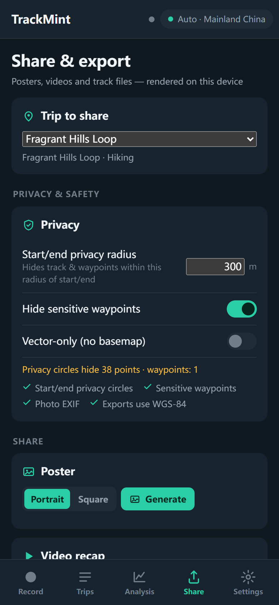
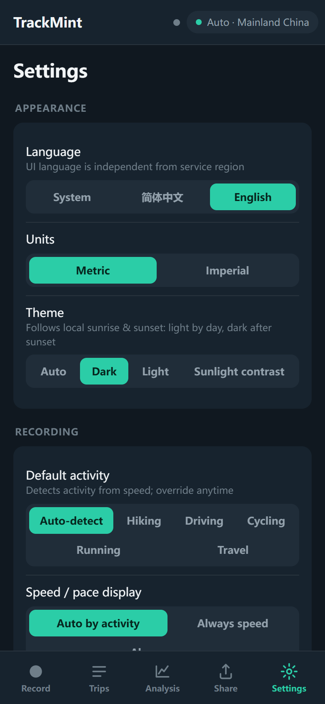

# TrackMint

[简体中文](README.md) | English

**Track + Mint** — open the page, record the journey, and mint it into a shareable poster or recap video. The Chinese name “迹刻” (jìkè) sounds like “即刻” (“right now”). The installed PWA uses the short name **TrackMint**.

TrackMint is a pure-frontend, offline-first trip recorder, analyzer and sharer. There is no backend and no sign-up: tracks and photos stay in your browser's IndexedDB. Map services switch automatically between mainland-China and global providers, and the installed PWA keeps working offline.

**Try it online: <https://peteliao.github.io/TrackMint/>**

## Screenshots

<table>
  <tr>
    <td align="center" width="50%"><br><sub><b>Live recording</b> · auto-detected activity, GPS signal</sub></td>
    <td align="center" width="50%"><br><sub><b>Trip library</b> · local-first, batch import</sub></td>
  </tr>
  <tr>
    <td align="center"><br><sub><b>Trip analysis</b> · elevation/speed charts, slope mix</sub></td>
    <td align="center"><br><sub><b>Share poster</b> · theme-aware, branded QR</sub></td>
  </tr>
  <tr>
    <td align="center"><br><sub><b>Share &amp; privacy</b> · privacy circles, poster and video</sub></td>
    <td align="center"><br><sub><b>Personalisation</b> · bilingual UI, three themes</sub></td>
  </tr>
</table>

## Features

- **Recording**: live track, distance, duration, speed, altitude and ascent, plus GPS signal strength; activity detection with a default name prompt when you finish; accidental-touch protection and a power-save lock screen
- **Analysis**: elevation profile and speed curve with map-linked hover; slope distribution, gap-aware segments, timeline and difficulty estimate
- **Waypoints**: start/end, viewpoint, food, supply, danger and more, with notes and photos; photo EXIF is stripped locally before storage
- **Privacy**: start/end privacy circles and sensitive-waypoint hiding; shared trip data lives only in the URL `#` fragment and never reaches a server
- **Sharing**: theme-aware square/portrait posters, track recap videos, trip score and comment, native share sheet; the QR code on posters and videos carries the brand mark
- **Route replay**: follow a reference track with off-route alerts and spoken waypoint announcements
- **Trip management**: batch GPX / GeoJSON / ZIP import and export, full-database backup and restore, automatic quarantine of corrupted data
- **Dual-region maps**: AMap/Tianditu in mainland China, OSM/OpenTopo/Esri elsewhere; automatic network probing with manual override
- **Coordinate policy**: storage, analysis and export always use WGS-84; GCJ-02 offsets are applied only at render time for basemaps such as AMap
- **Themes & language**: dark, light and sunlight-contrast themes, optionally following local sunrise and sunset; Simplified Chinese and English UI
- **PWA**: offline app shell and tile cache, installable to desktop or home screen

## Tech stack

- Build: [Vite 6](https://vite.dev/) + TypeScript + native ES Modules, no framework
- Maps: [MapLibre GL JS](https://maplibre.org/) with self-contained raster basemaps
- Storage: [Dexie](https://dexie.org/) (IndexedDB)
- Charts: [uPlot](https://github.com/leeoniya/uPlot)
- i18n: [i18next](https://www.i18next.com/)
- Files: fflate (ZIP), exifr (EXIF parsing/stripping)
- Offline: [vite-plugin-pwa](https://vite-pwa-org.netlify.app/) (Workbox)

## Local development

```bash
npm install
npm run dev       # development server
npm run typecheck # TypeScript type check
npm run build     # type check + production build (dist/)
npm run preview   # preview the production build
```

> Geolocation requires HTTPS or localhost. On mobile, open the deployed HTTPS URL and use “Add to Home Screen” for a near-native experience.

## Project layout

```
src/
  core/        storage, location engine, coordinate transforms, region probing, share/export, route replay
  ui/          shell, record, trips, analysis, share, settings views and map wrapper
  styles/      themes and component styles
public/icons/  PWA icons
docs/          README screenshots
```

## Privacy

Everything stays in your browser: nothing is uploaded or collected, and posters, videos and scores are rendered locally. Trip data in a share link exists only in the URL `#` fragment and never reaches a server. Photo EXIF location data is stripped before storage. Use full-database backup to move data between devices.

## License

[GPL-3.0](LICENSE) © 2026 Peteliao

Released under the GNU General Public License v3.0. You are free to use, modify and redistribute it, provided derivative works remain under the same license and retain the copyright notice.
