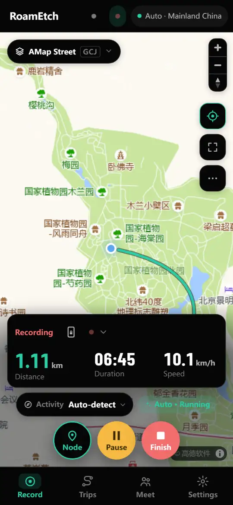
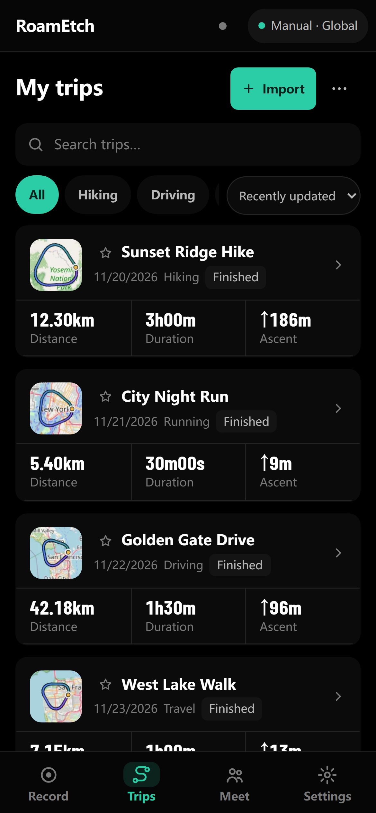
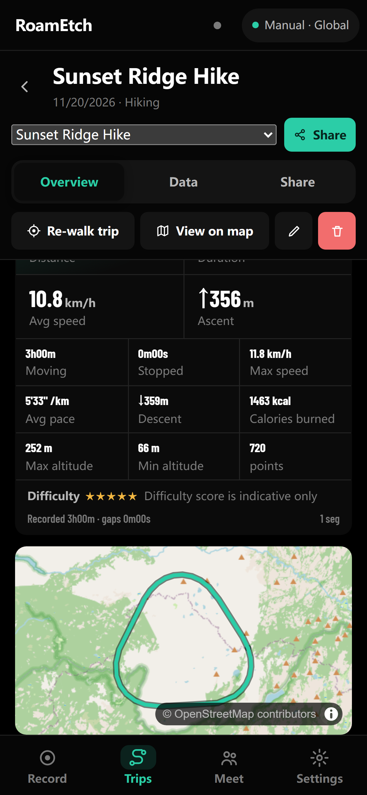

# RoamEtch: Open-source GPS tracker, GPX trip recorder, and encrypted live meetup chat PWA

[简体中文](README.md) | English

[](LICENSE)
[](https://www.typescriptlang.org/)
[](https://peteliao.github.io/RoamEtch/)
[](https://peteliao.github.io/RoamEtch/)

**RoamEtch** (Chinese name **迹刻**, pronounced *jìkè*) is a free, open-source GPS tracker and trip recorder that runs in your browser. **Roam** means roaming, road trips, and hiking exploration; **Etch** means etching journeys. Record hikes, bike rides, runs, road trips, and travel; analyze elevation and speed; import and export GPX; create shareable posters, replay videos, and self-contained trip pages; and stay together with end-to-end encrypted live meetups and ephemeral team chat. No account and no cloud trip library — your journeys stay in your own browser, and the installed PWA can open from your home screen like a native app.

**Try it online: [https://peteliao.github.io/RoamEtch/](https://peteliao.github.io/RoamEtch/)**<br>
Open it in any modern mobile browser. On iPhone and iPad, use Safari and choose “Add to Home Screen”.

> **No GPS?** The four main tabs are **Record, Trips, Team, and Settings**. Open Trips, load the demo trip, then choose **Overview / Data / Share** to explore analysis, posters, replay video, and self-contained HTML export. You can also visit `?demo=1`; contributors can use `?sim=1` to replay the demo as live GPS on a desktop.

> **TL;DR**: RoamEtch is a privacy-first, local-first GPX recorder PWA for hiking, cycling, running, road trips, and outdoor teams. It combines trip recording, elevation and speed analysis, shareable posters and videos, WGS-84 file export, and encrypted real-time teammate locations in one page — without sign-up.

## Screenshots

<p align="center">
  
  <br><sub><b>Live recording</b> · every step draws itself on the map, with distance, time, and speed updating live</sub>
</p>

<table>
  <tr>
    <td align="center" width="50%"><br><sub><b>Live recording</b> · track, altitude, ascent, GPS signal, activity detection</sub></td>
    <td align="center" width="50%"><br><sub><b>Live meetup</b> · teammate positions, distance and bearing, encrypted chat</sub></td>
  </tr>
  <tr>
    <td align="center"><br><sub><b>Trip library</b> · local tracks, yearly stats, city footprints, batch import and export</sub></td>
    <td align="center"><br><sub><b>Trip analysis</b> · elevation/speed charts, slope, score, map waypoints</sub></td>
  </tr>
  <tr>
    <td align="center"><br><sub><b>Share poster</b> · route map, score, elevation, branded QR</sub></td>
    <td align="center"><br><sub><b>Share &amp; privacy</b> · privacy crop, poster/video, GPX and HTML</sub></td>
  </tr>
  <tr>
    <td align="center"><br><sub><b>Personalisation</b> · bilingual UI, units, OLED-friendly themes</sub></td>
    <td align="center"><br><sub><b>Home-screen install</b> · step-by-step on iOS, Android, desktop</sub></td>
  </tr>
</table>

## Why RoamEtch

- **Local-first, data ownership included**: trips, track points, waypoints, and photos live in your browser's IndexedDB. There is no account and no cloud trip library; back up, restore, or export whenever you want.
- **One page, complete workflow**: record → analyze → poster/video/HTML → GPX/GeoJSON/KML. The whole pipeline runs locally, so you do not need to move files between several tools.
- **Privacy is the default**: shared trip data lives only in the URL `#` fragment; start/end privacy circles trim sensitive track sections; photo EXIF is stripped before storage; coordinates stay in WGS-84.
- **Live meetup and encrypted chat with ciphertext-only relays**: a versioned invite carries a random public room id and a 256-bit secret; the secret never reaches the relay. Positions, text, thumbnails, and WebRTC signaling are encrypted with AES-256-GCM and forwarded by a public MQTT broker or your own WebSocket relay. HD originals move only on demand over a DTLS-encrypted one-to-one DataChannel, bypassing the meetup relay; rooms and messages are not stored in the cloud.
- **Maps that adapt to the network**: AMap and Tianditu in mainland China; OpenStreetMap, OpenTopoMap, and Esri elsewhere — automatically selected or manually overridden, with custom raster tiles supported. GCJ-02 offsets are applied only at render time.
- **Open source and auditable**: GPL-3.0, TypeScript with native DOM, no opaque SDKs. Deploy the static build to any host you trust.

**Made for**: weekend hikes, trail-running sessions, city rides, long road trips, travel footprints, camping and convoy coordination, finding friends in crowded places, and anyone who needs WGS-84 GPX files for Garmin, Strava, TwoNav, or other compatible tools.

## Features

### Record: open the page and go

- Live distance, total and moving time, current/average speed, pace, altitude, ascent/descent, calories, and GPS signal strength.
- Automatic activity detection for hiking, driving, cycling, running, and travel; change the activity at any time while recording.
- Pause/resume, add waypoints mid-recording, rename in the result sheet, and resume as a new segment after the browser is backgrounded or the screen locks. Hold Finish for 1.2 seconds or swipe right to stop; taps and left swipes are ignored. The finished track stays visible for analysis or sharing.
- Three recording-frequency presets (high accuracy, balanced, power saving), screen wake lock, fullscreen, and a true-black OLED pocket lock to reduce accidental touches and battery drain on long trips. The pocket lock is progress-only, with no pause, resume, or finish controls and no recording-state changes; hold the ring for 1.5 seconds to unlock. Locking the screen with the power button or backgrounding the browser can still pause geolocation.
- **In-app photo waypoints**: while recording or paused, open Node and choose Photo waypoint to shoot in the viewfinder and link each photo to the current WGS-84 position and altitude. Flash, vibration, continuous shooting, thumbnail, undo, and a “Done (N)” counter are included. Each shot keeps the in-app 1600 px version plus a full-resolution original that “Save original” can hand to the system through the share sheet, save picker, or a download; browsers cannot silently write to the OS photo gallery. Photos stay in local IndexedDB and are never uploaded.
- **Multi-photo waypoint editor**: select several album images at once or open the camera and shoot a burst inside the node editor. Every captured or selected image is appended to the waypoint until you save it.
- **Pocket-lock quick camera**: drag the bottom-right camera knob left by at least 120 px in the OLED pocket lock. Taps and short drags are ignored; the camera closes after 20 seconds without interaction, and a saved shot returns to the black pocket lock after 3 seconds or offers “shoot again” / “lock now”.
- **Re-walk**: follow a reference track with off-route alerts and spoken waypoint type, name, and notes as you approach each node.

### Analyze: understand the route, not just the line

- A compact 13-metric card (4 hero metrics + 9 details) covering distance, duration, average/max speed, pace, moving/stopped time, ascent/descent, max/min altitude, calories, and track points.
- Elevation profile and speed chart linked to the map; hover on desktop or press and drag on touch to locate the same point on the map and read live values.
- Slope distribution, difficulty estimate, gap detection, timeline, and waypoints; calorie and trip-score estimates based on the selected activity.
- **GPS quality report** built from real samples: average fix accuracy, poor-fix ratio, time gaps, and altitude jumps, summarized as a 0–100 score with practical hints.
- One-click gap repair that sends only the endpoints of a detected gap to a public routing service (BRouter / OSRM) to rebuild the missing road track.

### Organize: keep a growing library manageable

- Favorite and pin trips, add up to 8 tags, search names and tags, and filter by activity or favorites; sort by recently updated, newest, longest distance, or name.
- **Yearly footprint**: trips, distance, ascent, active days, and a 12-month distribution for each year, computed entirely from local trips.
- **Footprint sharing**: export a 1080×1350 yearly summary card or a 9-second 1080×1920 video with the original on-device soundtrack, with preview, save, and native share. Only yearly totals are drawn — no trip names, tracks, places, waypoints, or photos.
- Favorites, tags, footprint stats, and share artwork stay on this device — nothing is uploaded.

### Share and export: turn a track into something people open

- **Posters**: portrait 1080×1920 and square 1080×1080, with route map, start/end time, trip score, GPS signal, elevation profile, sampled place names, and a branded QR code — theme-aware for dark and light canvases.
- **Replay videos**: 10 / 15 / 30-second map replays with synchronized metrics and one of four original looping soundtracks, synthesized on-device, randomly chosen by default or selected manually, and muxed into the MP4 or WebM export.
- **Self-contained HTML**: a single offline-capable page with full stats, elevation profile, zoomable map, waypoints, and photos — ideal for people who do not have the app.
- **Standard files**: WGS-84 GPX (works with Garmin, Strava, TwoNav, and similar tools), GeoJSON, and KML. Import GPX, XML, and ZIP batches; batch-export ZIP.
- **Verifiable backup**: the full-library ZIP carries SHA-256 content checksums. Restore shows the export time, contents, duplicate trips, and verification result, can download a snapshot of the current database first, and refuses corrupted archives. Before writing, restore validates archive size, paths, entries, and record relationships, then applies everything in one transaction that rolls back on failure. Backups can optionally be password-encrypted (PBKDF2-SHA-256 600,000 iterations + AES-256-GCM). New files use `.roametch.enc`; older `.trackmint.enc` backups remain restorable. Store unencrypted backups somewhere you trust.
- **Compact import link**: pack a simplified track and waypoints into a URL `#` fragment under 1.5 KB. Opening it imports the trip; it is not a public page and contains no photos.
- **Privacy review**: start/end privacy circles, sensitive-waypoint hiding, EXIF stripping, and WGS-84 export are shown together before you share or download.
- **Promo artwork**: generate a 1080×1350 card from Settings. Each theme ships eight designs with matching Chinese or English captions — local-first, yearly footprint, encrypted meetups, outdoor analysis, recap videos, background recovery, city footprints, and privacy — picked at random without immediate repeats and browsable with “Next”. Product info and a QR code only; no personal data.

### Live meetup: stay together in real time

- Create a meetup invite (`TM2.<roomId>.<secret>`) and share it as a link or QR code; joining can scan a live camera frame or decode a QR image from the album, and the session auto-ends after 1, 2, 4, or 8 hours. Old v1 12-character codes are rejected with an explicit message and must be replaced by a new invite.
- The map shows your position and every teammate with live distance and bearing; the list highlights the nearest teammate and stale signals, and can plan a meetup route to a selected teammate.
- The invite secret is the end-to-end key: HKDF-SHA-256 derives an AES-256-GCM key bound to the room id, with a per-session nonce prefix and monotonic counter. The room id (128 random bits) is independent of the secret (256 random bits), so the relay only sees a random public identifier and ciphertext. Ordinary packets use a strict per-sender sequence guard; RTC signaling is handled separately because redundant brokers can reorder it, and is protected by sender/message-id dedupe, a 30-second expiry, and per-sender rate limits. By default the app connects to several public MQTT WSS providers concurrently (EMQX China/global and mqtt-dashboard); the fastest node starts the session immediately, while every connected node also forwards outgoing ciphertext as redundancy. A custom MQTT URL and topic prefix in Settings or your own WebSocket relay are supported.
- Chat with online teammates after joining, with an unread badge. Messages live only in this tab's memory: late joiners see no history, messages are not replayed after disconnection, and everything is cleared when the session ends.
- **Encrypted photo chat**: the camera button opens an in-app viewfinder with flip, torch where supported, album import, optional caption, and a preview showing compressed dimensions/size. Images step down for weak networks (720 px long edge, 480 px in low-data mode, 56 KB raw cap), are encrypted end-to-end, and have a 5-second sender cooldown. Received photos show an encryption badge, open in an enlarged viewer, and can pin their optional capture location on the map.
- **On-demand HD originals**: with the default-off peer-to-peer original switch enabled, choosing **Load original** creates a one-to-one WebRTC DataChannel. The file holder is always the Offerer; the original travels in 16 KiB chunks and is checked against SHA-256. A failure, timeout, or checksum rejection affects only that original — location, text, and thumbnails keep working. The connection closes after 30 seconds idle.
- Only the latest 20 chat thumbnails remain in session memory; older payloads become expired placeholders. The sender caches at most 10 originals/50 MB and the receiver at most 4 blobs/64 MB. Chat photos and originals are never written to IndexedDB, included in backups, or uploaded to a RoamEtch server.
- Pause or resume sharing, remove a teammate on the host device, reset the invite (new room and key), or end the session. Expiry and manual end clear the local session.
- The invite, room, and chat exist only in the link `#` fragment and local memory; no cloud room is stored. Useful for hiking groups, convoys, camping, and crowded venues.

> Live meetup needs a network connection and browser location. Mobile operating systems may pause GPS when the screen is locked or the app is backgrounded. It is not an SOS or professional rescue tool. A frontend-only app cannot force a hostile client offline or erase positions already received by another device. When P2P originals are enabled, both devices can see each other’s network IP addresses during ICE negotiation and transfer; STUN/TURN servers also receive the relevant connection metadata. Original bytes bypass the meetup relay, but a configured TURN server may carry the still-encrypted DataChannel traffic.

### Install and go offline

- A one-time install prompt appears on mobile; the same guide is always available in Settings, with platform-specific steps for iOS, Android, and desktop.
- Installed PWAs launch from the home screen and cache the app shell plus map tiles you have already viewed.
- Loaded screens, recording, statistics, posters, videos, and file exports work locally. First visits, uncached map areas, live meetup, and some place/routing services still need network access.
- App updates reload only after you confirm; the update action is disabled while recording or paused so it cannot interrupt a trip. Fixes that fail to reach IndexedDB stay buffered and retry automatically.
- Geolocation requires HTTPS (or localhost) and browser location permission.
- Map rendering uses MapLibre GL JS 6 and requires WebGL2 (supported by current Chrome, Edge, Safari, and Firefox).

### Maps and coordinates

- Mainland China network: AMap streets/satellite and Tianditu; global network: OpenStreetMap, OpenTopoMap, Esri imagery, and more. Choose automatically or override manually.
- Custom raster tiles are supported. If a basemap is offline or CORS-restricted, RoamEtch falls back to a vector-only drawing.
- Storage, analysis, GPX, GeoJSON, and KML always use WGS-84. GCJ-02 is applied only at render time for basemaps such as AMap, so source data is never polluted.

### Themes and languages

- OLED-friendly true-black dark, light, and high-contrast sunlight themes, optionally switched by local sunrise and sunset.
- Simplified Chinese and English UI, metric and imperial units. UI language is independent from the map service region.

## Install on your phone or desktop

1. **iPhone / iPad**: open the [live app](https://peteliao.github.io/RoamEtch/) in Safari, tap **Share**, choose **Add to Home Screen**, then **Add**. iOS only exposes installation through the Safari share menu.
2. **Android**: open the app in Chrome or Edge, open the browser menu, and choose **Install app** or **Add to Home screen**.
3. **Desktop**: click the install icon in the Chrome/Edge address bar when it appears, or open **Settings → Home-screen icon** inside the app for step-by-step guidance.

Installation never uploads your data. Tracks and photos remain on this device. Export a full backup before clearing browser data or uninstalling the PWA.

## Quick start

Use the hosted app — no installation required:

**<https://peteliao.github.io/RoamEtch/>**

Local development or self-hosting:

```bash
npm install
npm run dev        # development server
npm run typecheck  # TypeScript type check
npm test           # core algorithm unit tests
npm run build      # type check + production build (dist/)
npm run preview    # preview the production build
```

`dist/` is fully static. Deploy it to GitHub Pages, Cloudflare Pages, Netlify, Vercel, or any static web server. There is no business backend and no database to provision. CI runs typecheck, unit tests, Playwright end-to-end smoke tests, and the production build on every push and pull request. Pushing a `v*` tag publishes a GitHub Release with `roametch-dist.zip` and pushes the container images.

### Docker self-hosting

The repository includes a multi-stage `Dockerfile` and an `nginx.conf` with correct PWA cache headers for `sw.js` and `index.html`. Release tags publish images to GitHub Container Registry:

```bash
docker run --rm -p 8080:80 ghcr.io/peteliao/roametch:latest
# open http://localhost:8080
```

Or build from source:

```bash
docker build -t roametch .
docker run --rm -p 8080:80 roametch
```

Geolocation and PWA installation on phones require HTTPS (except `localhost`), so put a TLS reverse proxy such as Caddy, Nginx, or Cloudflare Tunnel in front. This also works on a home NAS or a private server and does not depend on GitHub Pages.

### Private meetup relay (optional)

The default setup uses several public MQTT nodes concurrently and is suitable for testing. For a more stable or private relay, use the minimal blind WebSocket relay in [`relay/`](relay/README.md):

```bash
docker run --rm -p 8080:8080 ghcr.io/peteliao/roametch-relay:latest
# or from source:
cd relay && npm install && npm start
# or
docker build -t roametch-relay ./relay
docker run --rm -p 8080:8080 roametch-relay
```

Then choose **Settings → Team relay → Custom WS relay** and enter `wss://your-host/room/{room}`. The relay forwards ciphertext only and stores no messages.

## Architecture

- Build: [Vite 6](https://vite.dev/) + TypeScript + native ES Modules, no frontend framework
- Maps: [MapLibre GL JS](https://maplibre.org/) with self-contained raster styles and no external style/font dependency
- Storage: [Dexie](https://dexie.org/) (IndexedDB); statistics run in a Web Worker
- Charts: [uPlot](https://github.com/leeoniya/uPlot)
- i18n: [i18next](https://www.i18next.com/)
- Files and photos: fflate (ZIP), exifr (EXIF parsing and stripping)
- Offline: [vite-plugin-pwa](https://vite-pwa-org.netlify.app/) (Workbox)
- Meetup: v2 invite (random public room id + 256-bit secret) + HKDF-SHA-256 + AES-256-GCM; ordinary packets use per-sender sequence replay protection, while RTC signaling uses sender/message-id dedupe, expiry, and per-sender rate limits. Positions, text, thumbnails, and signaling use concurrent public MQTT WSS nodes or a custom WebSocket blind relay; HD originals use on-demand WebRTC DataChannels.
- Camera: `getUserMedia` + inline video + Canvas; chat thumbnails are weak-network compressed and only the latest 20 remain in memory, while local shots become photo waypoints linked to WGS-84 coordinates and can export a full-resolution original during the session
- Tests: Vitest covers coordinate conversion, track statistics, backup integrity and encryption, yearly footprints, GPS quality, GPX/KML/GeoJSON, share links, meetup crypto and publish cadence, MQTT frame validation, QR decoding, chat-image compression/validation, RTC signaling, ICE configuration, caches, and the transfer state machine. Playwright covers demo analysis, privacy cropping, posters, text-only HTML export, the encrypted backup round-trip, in-app photo bursts/save/undo/original download, multi-photo nodes, two-client encrypted text and image chat, camera and image QR join, public MQTT delivery, on-demand WebRTC originals/privacy refusal/room-reset races, and OLED anti-mistouch/auto-lock; CI runs typecheck, unit tests, E2E, and the production build
- Self-hosting: multi-stage Dockerfile + nginx.conf; an optional minimal blind relay template lives in [`relay/`](relay/README.md)

```text
GPS / GPX / photos
       │
       ▼
  recorder ──────► IndexedDB (Dexie) ──────► statistics worker
       │                    │
       ├── live map         ├── charts / score / gap repair
       │                    ├── poster / video / standalone HTML
       │                    └── GPX / GeoJSON / KML / backup
       │
       └── live meetup
             ├── positions / text / thumbnails / RTC signals
             │      └── on-device encryption ──► public or custom relay (ciphertext only)
             └── requested HD original
                    └── on-demand WebRTC DataChannel ──► teammate (DTLS; optional TURN)
```

## How it compares

| Capability | Typical cloud fitness platform | Generic GPS logger | RoamEtch |
| --- | --- | --- | --- |
| Account and cloud | Usually requires an account | Not always | No account, no cloud trip library |
| Track storage | Vendor cloud | Local files or device | Local IndexedDB with full backup |
| GPX import / export | Often limited by plan or format | Usually supported | Import GPX/XML/ZIP; export GPX/GeoJSON/KML |
| Elevation, speed, slope analysis | Yes | Basic or external tools | Built in, with charts, score, and gap repair |
| Poster / video / standalone HTML | Rare | Rare | All generated locally |
| Live teammate locations and chat | Yes, through cloud accounts | Uncommon | End-to-end encrypted temporary rooms and chat |
| China / global basemaps | Depends on product | Usually manual setup | Automatic detection plus manual override |
| Offline use | Limited | Recording often works offline | PWA shell + previously viewed map tiles |
| Open source and auditable | No | Depends on project | GPL-3.0, full source available |

## Privacy and data boundaries

RoamEtch is designed to keep data on your device, but “local-first” does not mean every network request disappears. Here is the precise boundary:

- **Stored locally**: trips, track points, waypoints, photo thumbnails, and settings live in IndexedDB/localStorage. There is no account system, business backend, or in-app analytics reporting.
- **Share links**: trip data and meetup invites are placed only in the URL `#` fragment. Browsers do not send the fragment to servers; anyone who receives the link can read the data inside, so share only with people you trust.
- **Live meetup**: positions, text, thumbnails, and RTC signaling are encrypted on-device. The default public MQTT relay or a custom relay sees only ciphertext and the random public room id. The room id (128 random bits) and the invite secret (256 random bits) are generated independently, so observing the topic reveals no key material. Leaking the invite does expose positions and chat. Old v1 invites are rejected rather than downgraded. A relay can observe ciphertext packet sizes and timing, so it can infer that a thumbnail or signal is being sent, but cannot see its contents.
- **Photos and P2P originals**: EXIF location data is stripped before local storage. Chat thumbnails are redrawn/compressed in memory from the camera or album, never written to the device gallery or IndexedDB, and only the latest 20 remain in the session. HD originals are off by default and move only after an explicit request over a DTLS-encrypted WebRTC DataChannel, with SHA-256 and image validation. They bypass the meetup relay and remain in bounded memory caches, but both devices can observe each other’s network IP addresses; STUN/TURN servers receive connection metadata and a configured TURN server may relay encrypted bytes. Exported posters, videos, and HTML use the locally processed images only.
- **External service requests**: basemap tiles, elevation, place-name, and routing services require network access and receive the coordinates/viewport needed to render or compute a result, plus normal network information such as your IP. When generating a poster or video, sampled coordinates may be sent to OpenStreetMap-based reverse geocoding to label the route, and the result is cached locally. Gap repair and meetup routing send endpoints only when you explicitly trigger them. These requests never upload photos or the full trip library.
- **Device risk**: clearing browser data, uninstalling the PWA, or changing devices removes local trips — keep a full backup. Anyone who can unlock your device may be able to read browser storage.
- **Full backups**: the backup ZIP contains complete tracks, waypoints, and photos. By default it is not encrypted, so anyone with the file can read it. You can set a password when exporting to produce an encrypted `.roametch.enc` file; older `.trackmint.enc` backups remain restorable (PBKDF2-SHA-256 600,000 iterations + AES-256-GCM). The password is never stored and cannot be recovered. Either way, keep backups somewhere you trust.
- **Original music**: replay-video soundtracks are synthesized in the browser; no external music files are downloaded or bundled.

## FAQ

### Is RoamEtch free and open source?

Yes. It is released under GPL-3.0. The hosted version is free, with no account or paywall, and you can deploy `dist/` to your own static host.

### Does it upload my tracks?

Not to a RoamEtch business server: there is no business backend or cloud trip library. Third-party basemap, elevation, place-name, and routing services receive coordinates required for those specific features; see “Privacy and data boundaries” above.

### Can I record offline?

Yes. Once installed as a PWA, the app shell and map tiles you have viewed are cached, and recording, statistics, and exports run locally. Uncached map areas, online place names, live meetup, and some routing services need network access.

### Which file formats are supported?

Import: GPX, XML, and ZIP archives containing GPX/XML. Export: GPX, GeoJSON, KML, image posters, MP4/WebM replay videos, self-contained HTML, and full-library backups. GPX, GeoJSON, and KML use WGS-84.

### Is live meetup secure?

Positions, text, thumbnails, and WebRTC signaling use AES-256-GCM end-to-end encryption; the invite carries a 256-bit secret, and the public room id is independent of it. Public or custom relays only forward ciphertext; messages and thumbnails live only in memory and have no replay history. Thumbnails have a 5-second sender cooldown and only the latest 20 remain in memory. HD originals are disabled by default: after you explicitly enable P2P and load one, a one-to-one DTLS DataChannel verifies SHA-256 and transfers it without the meetup relay. This exposes the devices’ network IP addresses to each other and relevant metadata to STUN/TURN. Original bytes never enter IndexedDB or backups. Send invites through a trusted channel, not a public group. Old v1 12-character codes are retired and never silently downgraded. Sender identity authentication, key rotation after membership changes, and forward secrecy remain future protocol phases. RoamEtch is not an SOS/rescue device and cannot stop someone who has received a position, message, or photo from saving it.

### Does recording continue with the screen off?

RoamEtch requests a screen wake lock while recording, and the OLED pocket lock keeps a true-black progress dashboard visible and awake without hiding the page. It does not change recording state and has no pause, resume, or finish controls; hold the ring for 1.5 seconds to unlock, while a tap does nothing. It cannot prevent system sleep: iOS and Android may still pause browser geolocation when the screen is locked with the power button or the app is backgrounded. RoamEtch re-locates and resumes when you return. Drag the pocket-lock camera knob left by at least 120 px to shoot without unlocking; the camera closes after 20 seconds without interaction and returns to the black lock 3 seconds after a shot. Behavior depends on the OS and battery policy, so keep the app in the foreground for critical activities.

### Why do maps differ between regions?

RoamEtch selects a service stack by network region: AMap/Tianditu in mainland China and OpenStreetMap/OpenTopoMap/Esri elsewhere. You can override the basemap manually. GCJ-02 offsets are applied only at render time; storage and export remain WGS-84.

### How do I install it on my phone?

On iPhone/iPad, open in Safari and use **Share → Add to Home Screen**. On Android, use the Chrome/Edge menu and choose **Install app** or **Add to Home screen**. On desktop, click the install icon in the address bar. The in-app Settings page also walks through each platform.

### How do I delete or migrate my data?

Delete a single trip from the trip library, or clear site data in the browser to remove everything locally. Use **Backup / Restore** to migrate devices. Share links and individual exports do not include the full photo library, so they are not a substitute for a full backup.

### Why the name “迹刻”?

Roam means roaming, road trips, and hiking exploration; Etch means etching journeys. The Chinese name 迹刻 sounds like 即刻 (“right now”) — open the page, record immediately, and carve the journey onto the map.

## Contributing

Issues and pull requests are welcome. When reporting a bug, include the browser/OS, whether the app is installed as a PWA, the map region, reproduction steps, and expected behavior. Remove meetup invites, share links, and personal tracks first. Before submitting code, run:

```bash
npm run typecheck
npm test
npm run build
```

Run `cd relay && npm test` as well when changing the relay. Project conventions, dual-region test methods, and debug entry points are in [CONTRIBUTING.md](CONTRIBUTING.md); modules and data flow are in [docs/ARCHITECTURE.md](docs/ARCHITECTURE.md); the security model and private vulnerability reporting are in [SECURITY.md](SECURITY.md); community standards are in [CODE_OF_CONDUCT.md](CODE_OF_CONDUCT.md); release notes are in [CHANGELOG.md](CHANGELOG.md).

The project is committed to local-first storage, no accounts, no cloud trip library, and WGS-84 data. When adding a dependency or external service, document its privacy impact as well.

## License

[GPL-3.0](LICENSE) © 2026 Peteliao

Released under the GNU General Public License v3.0. You are free to use, modify, and redistribute it, provided derivative works remain under the same license and retain the copyright notice.
