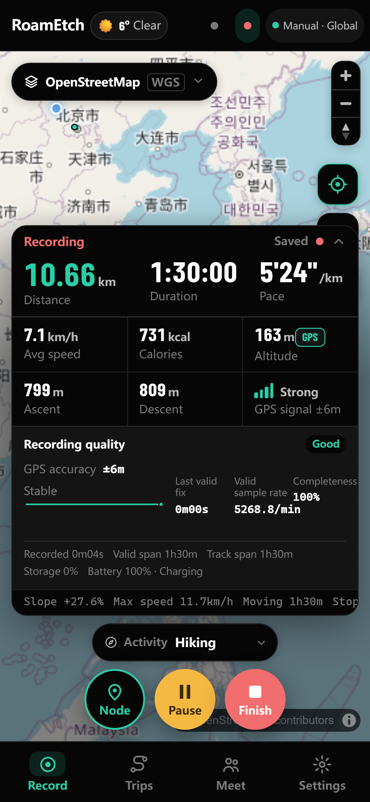
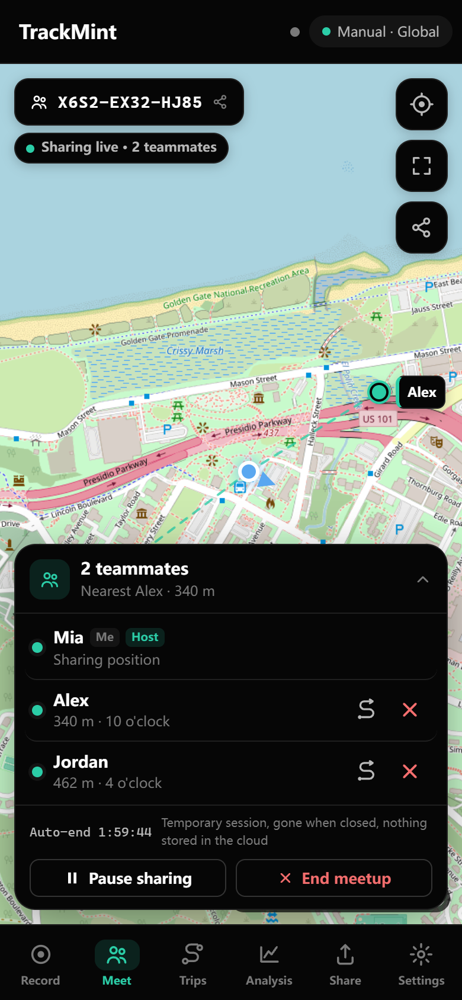
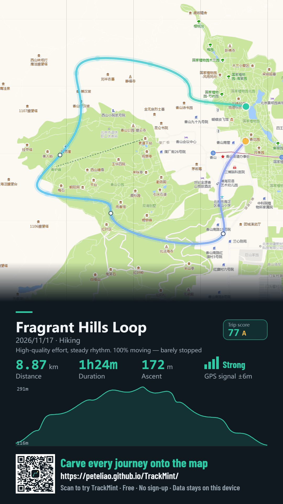
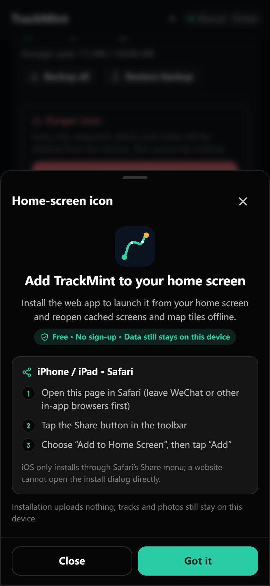

# TrackMint: Open-source GPS tracker, GPX trip recorder, and encrypted live meetup chat PWA

[简体中文](README.md) | English

[](LICENSE)
[](https://www.typescriptlang.org/)
[](https://peteliao.github.io/TrackMint/)
[](https://peteliao.github.io/TrackMint/)

**TrackMint** (Chinese name **迹刻**, pronounced *jìkè*) is a free, open-source GPS tracker and trip recorder that runs in your browser. Record hikes, bike rides, runs, road trips, and travel; analyze elevation and speed; import and export GPX; mint shareable posters, replay videos, and self-contained trip pages; and stay together with end-to-end encrypted live meetups and ephemeral team chat. No account and no cloud trip library — your journeys stay in your own browser, and the installed PWA can open from your home screen like a native app.

**Try it online: [https://peteliao.github.io/TrackMint/](https://peteliao.github.io/TrackMint/)**<br>
Open it in any modern mobile browser. On iPhone and iPad, use Safari and choose “Add to Home Screen”.

> **TL;DR**: TrackMint is a privacy-first, local-first GPX recorder PWA for hiking, cycling, running, road trips, and outdoor teams. It combines trip recording, elevation and speed analysis, shareable posters and videos, WGS-84 file export, and encrypted real-time teammate locations in one page — without sign-up.

## Screenshots

<table>
  <tr>
    <td align="center" width="50%"><br><sub><b>Live recording</b> · track, altitude, ascent, GPS signal, activity detection</sub></td>
    <td align="center" width="50%"><br><sub><b>Live meetup</b> · teammate positions, distance and bearing, encrypted chat</sub></td>
  </tr>
  <tr>
    <td align="center"><br><sub><b>Trip library</b> · local tracks, filters, batch import and export</sub></td>
    <td align="center"><br><sub><b>Trip analysis</b> · elevation/speed charts, slope, score, map waypoints</sub></td>
  </tr>
  <tr>
    <td align="center"><br><sub><b>Share poster</b> · route map, score, elevation, branded QR</sub></td>
    <td align="center"><br><sub><b>Share &amp; privacy</b> · privacy crop, poster/video, GPX and HTML</sub></td>
  </tr>
  <tr>
    <td align="center"><br><sub><b>Personalisation</b> · bilingual UI, units, OLED-friendly themes</sub></td>
    <td align="center"><br><sub><b>Home-screen install</b> · step-by-step on iOS, Android, desktop</sub></td>
  </tr>
</table>

## Why TrackMint

- **Local-first, data ownership included**: trips, track points, waypoints, and photos live in your browser's IndexedDB. There is no account and no cloud trip library; back up, restore, or export whenever you want.
- **One page, complete workflow**: record → analyze → poster/video/HTML → GPX/GeoJSON/KML. The whole pipeline runs locally, so you do not need to move files between several tools.
- **Privacy is the default**: shared trip data lives only in the URL `#` fragment; start/end privacy circles trim sensitive track sections; photo EXIF is stripped before storage; coordinates stay in WGS-84.
- **Live meetup and encrypted chat with ciphertext-only relays**: a 12-character code doubles as the end-to-end key. Positions and chat messages are encrypted with AES-GCM and forwarded by a public MQTT broker or your own WebSocket relay; rooms and messages are not stored in the cloud.
- **Maps that adapt to the network**: AMap and Tianditu in mainland China; OpenStreetMap, OpenTopoMap, and Esri elsewhere — automatically selected or manually overridden, with custom raster tiles supported. GCJ-02 offsets are applied only at render time.
- **Open source and auditable**: GPL-3.0, TypeScript with native DOM, no opaque SDKs. Deploy the static build to any host you trust.

**Made for**: weekend hikes, trail-running sessions, city rides, long road trips, travel footprints, camping and convoy coordination, finding friends in crowded places, and anyone who needs WGS-84 GPX files for Garmin, Strava, TwoNav, or other compatible tools.

## Features

### Record: open the page and go

- Live distance, total and moving time, current/average speed, pace, altitude, ascent/descent, calories, and GPS signal strength.
- Automatic activity detection for hiking, driving, cycling, running, and travel; change the activity at any time while recording.
- Pause/resume, add waypoints mid-recording, rename on finish, and resume as a new segment after the browser is backgrounded or the screen locks.
- Three recording-frequency presets (high accuracy, balanced, power saving), screen wake lock, fullscreen, and a true-black OLED pocket lock to reduce accidental touches and battery drain on long trips.
- **Re-walk**: follow a reference track with off-route alerts and spoken waypoint type, name, and notes as you approach each node.

### Analyze: understand the route, not just the line

- Thirteen metric cards covering distance, duration, average/max speed, pace, moving/stopped time, ascent/descent, max/min altitude, calories, and track points.
- Elevation profile and speed chart linked to the map; hover the chart to locate the same point on the map.
- Slope distribution, difficulty estimate, gap detection, timeline, and waypoints; calorie and trip-score estimates based on the selected activity.
- One-click gap repair that sends only the endpoints of a detected gap to a public routing service (BRouter / OSRM) to rebuild the missing road track.

### Share and export: turn a track into something people open

- **Posters**: portrait 1080×1920 and square 1080×1080, with route map, start/end time, trip score, GPS signal, elevation profile, sampled place names, and a branded QR code — theme-aware for dark and light canvases.
- **Replay videos**: 10 / 15 / 30-second map replays with synchronized metrics, exported as MP4 or WebM depending on browser support, then downloaded or opened in the system share sheet.
- **Self-contained HTML**: a single offline-capable page with full stats, elevation profile, zoomable map, waypoints, and photos — ideal for people who do not have the app.
- **Standard files**: WGS-84 GPX (works with Garmin, Strava, TwoNav, and similar tools), GeoJSON, and KML. Import GPX, XML, and ZIP batches; batch-export ZIP; back up and restore the whole library.
- **Compact import link**: pack a simplified track and waypoints into a URL `#` fragment under 1.5 KB. Opening it imports the trip; it is not a public page and contains no photos.
- **Privacy review**: start/end privacy circles, sensitive-waypoint hiding, EXIF stripping, and WGS-84 export are shown together before you share or download.

### Live meetup: stay together in real time

- Create a 12-character meetup code or invite teammates with a link or QR code; the session auto-ends after 1, 2, 4, or 8 hours.
- The map shows your position and every teammate with live distance and bearing; the list highlights the nearest teammate and stale signals, and can plan a meetup route to a selected teammate.
- The meetup code is also the end-to-end key. Positions and chat messages are encrypted on-device and forwarded by the default public EMQX MQTT WSS broker (custom MQTT URL and topic prefix supported in Settings) or a custom WebSocket relay; the relay sees ciphertext only.
- Chat with online teammates after joining, with an unread badge. Messages live only in this tab's memory: late joiners see no history, messages are not replayed after disconnection, and everything is cleared when the session ends.
- Pause or resume sharing, remove a teammate on the host device, reset the meetup code, or end the session. Expiry and manual end clear the local session.
- The code, room, and chat exist only in the link `#` fragment and local memory; no cloud room is stored. Useful for hiking groups, convoys, camping, and crowded venues.

> Live meetup needs a network connection and browser location. Mobile operating systems may pause GPS when the screen is locked or the app is backgrounded. It is not an SOS or professional rescue tool. A frontend-only app cannot force a hostile client offline or erase positions already received by another device.

### Install and go offline

- A one-time install prompt appears on mobile; the same guide is always available in Settings, with platform-specific steps for iOS, Android, and desktop.
- Installed PWAs launch from the home screen and cache the app shell plus map tiles you have already viewed.
- Loaded screens, recording, statistics, posters, videos, and file exports work locally. First visits, uncached map areas, live meetup, and some place/routing services still need network access.
- Geolocation requires HTTPS (or localhost) and browser location permission.

### Maps and coordinates

- Mainland China network: AMap streets/satellite and Tianditu; global network: OpenStreetMap, OpenTopoMap, Esri imagery, and more. Choose automatically or override manually.
- Custom raster tiles are supported. If a basemap is offline or CORS-restricted, TrackMint falls back to a vector-only drawing.
- Storage, analysis, GPX, GeoJSON, and KML always use WGS-84. GCJ-02 is applied only at render time for basemaps such as AMap, so source data is never polluted.

### Themes and languages

- OLED-friendly true-black dark, light, and high-contrast sunlight themes, optionally switched by local sunrise and sunset.
- Simplified Chinese and English UI, metric and imperial units. UI language is independent from the map service region.

## Install on your phone or desktop

1. **iPhone / iPad**: open the [live app](https://peteliao.github.io/TrackMint/) in Safari, tap **Share**, choose **Add to Home Screen**, then **Add**. iOS only exposes installation through the Safari share menu.
2. **Android**: open the app in Chrome or Edge, open the browser menu, and choose **Install app** or **Add to Home screen**.
3. **Desktop**: click the install icon in the Chrome/Edge address bar when it appears, or open **Settings → Home-screen icon** inside the app for step-by-step guidance.

Installation never uploads your data. Tracks and photos remain on this device. Export a full backup before clearing browser data or uninstalling the PWA.

## Quick start

Use the hosted app — no installation required:

**<https://peteliao.github.io/TrackMint/>**

Local development or self-hosting:

```bash
npm install
npm run dev       # development server
npm run typecheck # TypeScript type check
npm run build     # type check + production build (dist/)
npm run preview   # preview the production build
```

`dist/` is fully static. Deploy it to GitHub Pages, Cloudflare Pages, Netlify, Vercel, or any static web server. There is no business backend and no database to provision.

## Architecture

- Build: [Vite 6](https://vite.dev/) + TypeScript + native ES Modules, no frontend framework
- Maps: [MapLibre GL JS](https://maplibre.org/) with self-contained raster styles and no external style/font dependency
- Storage: [Dexie](https://dexie.org/) (IndexedDB); statistics run in a Web Worker
- Charts: [uPlot](https://github.com/leeoniya/uPlot)
- i18n: [i18next](https://www.i18next.com/)
- Files and photos: fflate (ZIP), exifr (EXIF parsing and stripping)
- Offline: [vite-plugin-pwa](https://vite-pwa-org.netlify.app/) (Workbox)
- Meetup: 12-character code + HKDF-SHA-256 key derivation + AES-GCM end-to-end encryption; positions and ephemeral chat both use MQTT WSS or a custom WebSocket blind relay

```text
GPS / GPX / photos
       │
       ▼
  recorder ──────► IndexedDB (Dexie) ──────► statistics worker
       │                    │
       ├── live map         ├── charts / score / gap repair
       │                    ├── poster / video / standalone HTML
       │                    └── GPX / GeoJSON / KML / backup
       │
       └── live meetup: on-device encryption ──► public or custom relay (ciphertext only)
```

## How it compares

| Capability | Typical cloud fitness platform | Generic GPS logger | TrackMint |
| --- | --- | --- | --- |
| Account and cloud | Usually requires an account | Not always | No account, no cloud trip library |
| Track storage | Vendor cloud | Local files or device | Local IndexedDB with full backup |
| GPX import / export | Often limited by plan or format | Usually supported | Import GPX/XML/ZIP; export GPX/GeoJSON/KML |
| Elevation, speed, slope analysis | Yes | Basic or external tools | Built in, with charts, score, and gap repair |
| Poster / video / standalone HTML | Rare | Rare | All generated locally |
| Live teammate locations and chat | Yes, through cloud accounts | Uncommon | End-to-end encrypted temporary rooms and chat |
| China / global basemaps | Depends on product | Usually manual setup | Automatic detection plus manual override |
| Offline use | Limited | Recording often works offline | PWA shell + previously viewed map tiles |
| Open source and auditable | No | Depends on project | GPL-3.0, full source available |

## Privacy and data boundaries

TrackMint is designed to keep data on your device, but “local-first” does not mean every network request disappears. Here is the precise boundary:

- **Stored locally**: trips, track points, waypoints, photo thumbnails, and settings live in IndexedDB/localStorage. There is no account system, business backend, or in-app analytics reporting.
- **Share links**: trip data and meetup codes are placed only in the URL `#` fragment. Browsers do not send the fragment to servers; anyone who receives the link can read the data inside, so share only with people you trust.
- **Live meetup**: positions and chat messages are encrypted on-device. The default public MQTT relay and any custom relay see only ciphertext and a random topic identifier; rooms and messages are not stored. The meetup code is also the decryption key — leaking the code leaks positions and chat.
- **Photos**: EXIF location data is stripped before storage; exported posters, videos, and HTML use the locally processed images only.
- **External service requests**: basemap tiles, elevation, place-name, and routing services require network access and receive the coordinates/viewport needed to render or compute a result, plus normal network information such as your IP. When generating a poster or video, sampled coordinates may be sent to OpenStreetMap-based reverse geocoding to label the route, and the result is cached locally. Gap repair and meetup routing send endpoints only when you explicitly trigger them. These requests never upload photos or the full trip library.
- **Device risk**: clearing browser data, uninstalling the PWA, or changing devices removes local trips — keep a full backup. Anyone who can unlock your device may be able to read browser storage.

## FAQ

### Is TrackMint free and open source?

Yes. It is released under GPL-3.0. The hosted version is free, with no account or paywall, and you can deploy `dist/` to your own static host.

### Does it upload my tracks?

Not to a TrackMint business server: there is no business backend or cloud trip library. Third-party basemap, elevation, place-name, and routing services receive coordinates required for those specific features; see “Privacy and data boundaries” above.

### Can I record offline?

Yes. Once installed as a PWA, the app shell and map tiles you have viewed are cached, and recording, statistics, and exports run locally. Uncached map areas, online place names, live meetup, and some routing services need network access.

### Which file formats are supported?

Import: GPX, XML, and ZIP archives containing GPX/XML. Export: GPX, GeoJSON, KML, image posters, MP4/WebM replay videos, self-contained HTML, and full-library backups. GPX, GeoJSON, and KML use WGS-84.

### Is live meetup secure?

Positions and chat messages use AES-GCM end-to-end encryption, and the 12-character meetup code doubles as the key. Public or custom relays only forward ciphertext; chat lives only in memory and has no replay history. Send codes through a trusted channel, not a public group. TrackMint is not an SOS/rescue device and cannot stop someone who has received a position or message from saving it.

### Does recording continue with the screen off?

TrackMint requests a screen wake lock while recording and can resume as a new segment after interruptions, including the OLED pocket lock. iOS and Android may still pause browser geolocation when the screen is locked or the app is backgrounded; TrackMint re-locates and resumes when you return. Behavior depends on the OS and battery policy, so keep the app in the foreground for critical activities.

### Why do maps differ between regions?

TrackMint selects a service stack by network region: AMap/Tianditu in mainland China and OpenStreetMap/OpenTopoMap/Esri elsewhere. You can override the basemap manually. GCJ-02 offsets are applied only at render time; storage and export remain WGS-84.

### How do I install it on my phone?

On iPhone/iPad, open in Safari and use **Share → Add to Home Screen**. On Android, use the Chrome/Edge menu and choose **Install app** or **Add to Home screen**. On desktop, click the install icon in the address bar. The in-app Settings page also walks through each platform.

### How do I delete or migrate my data?

Delete a single trip from the trip library, or clear site data in the browser to remove everything locally. Use **Backup / Restore** to migrate devices. Share links and individual exports do not include the full photo library, so they are not a substitute for a full backup.

### Why the name “迹刻”?

Track + Mint: recording a track and minting it into something worth sharing. The Chinese name 迹刻 sounds like 即刻 (“right now”) — open the page, record immediately, and carve the journey onto the map.

## Contributing

Issues and pull requests are welcome. When reporting a bug, include the browser/OS, reproduction steps, and expected behavior. Before submitting code, run:

```bash
npm run typecheck
npm run build
```

The project is committed to local-first storage, no accounts, no cloud trip library, and WGS-84 data. When adding a dependency or external service, document its privacy impact as well.

## License

[GPL-3.0](LICENSE) © 2026 Peteliao

Released under the GNU General Public License v3.0. You are free to use, modify, and redistribute it, provided derivative works remain under the same license and retain the copyright notice.
