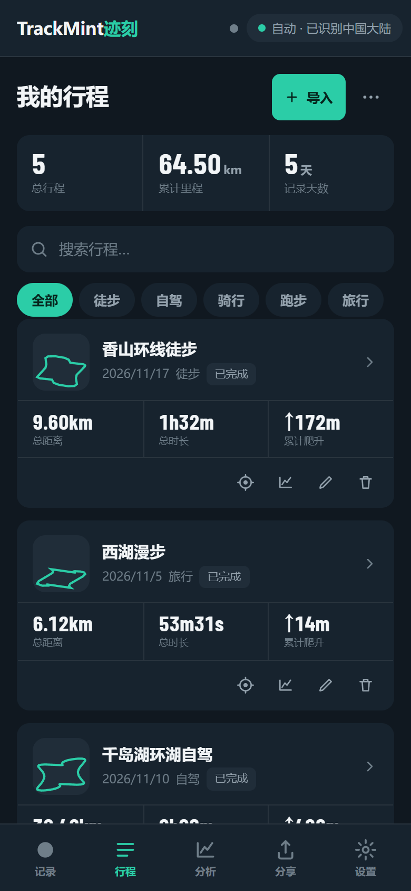
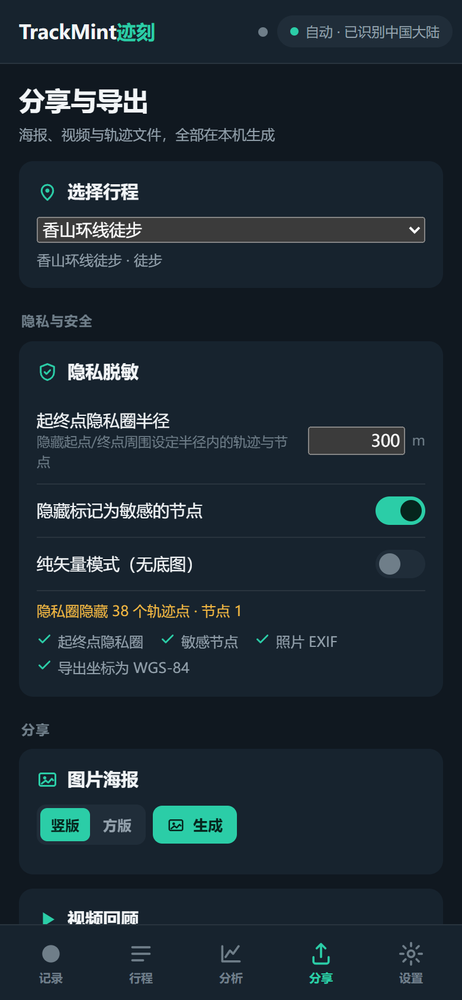

# TrackMint迹刻

简体中文 | [English](README.en.md)

**Track（轨迹）+ Mint（铸造/焕新）**；中文名“迹刻”谐音**“即刻”**——打开网页即刻记录，当场生成可分享的海报与轨迹视频。PWA 桌面图标短名：**TrackMint**。

TrackMint迹刻 是一个纯前端、离线优先的行程记录与分析分享工具：无后端、无需注册，轨迹与照片只保存在本机浏览器（IndexedDB）；国内/海外地图服务自动切换，安装为 PWA 后可离线使用。

**在线体验：<https://peteliao.github.io/TrackMint/>**

## 界面预览

<table>
  <tr>
    <td align="center" width="50%"><br><sub><b>实时记录</b> · 活动自动识别、GPS 信号</sub></td>
    <td align="center" width="50%"><br><sub><b>行程管理</b> · 本地优先、批量导入</sub></td>
  </tr>
  <tr>
    <td align="center"><br><sub><b>行程分析</b> · 高程/速度曲线、坡度分布</sub></td>
    <td align="center"><br><sub><b>分享海报</b> · 主题感知、品牌二维码</sub></td>
  </tr>
  <tr>
    <td align="center"><br><sub><b>分享与隐私</b> · 隐私圈裁剪、海报与视频</sub></td>
    <td align="center"><br><sub><b>个性化</b> · 中英双语、三套主题</sub></td>
  </tr>
</table>

## 功能

- **记录**：实时轨迹、距离/时长/速度/海拔/爬升、GPS 信号强度；活动类型自动识别，结束时可命名并自动生成默认名称；支持防误触与省电锁屏模式
- **分析**：高程剖面、速度曲线，悬停曲线地图同步定位；坡度分布、分段间隙识别、时间线与难度参考
- **节点**：起点/终点/观光/餐饮/补给/危险等类型，可添加说明与照片；照片 EXIF 在本地剥离后再存储
- **隐私**：起终点隐私圈裁剪、敏感节点隐藏；分享链接中的行程数据只放在 URL `#` 片段，永不经过服务器
- **分享**：主题感知的方形/竖版海报、轨迹回顾视频、行程评分与评语、系统分享；海报与视频二维码中心带品牌标志
- **重走行程**：沿参考轨迹跟随导航，偏离提醒；到达节点时语音播报类型、名称与说明
- **行程管理**：GPX / GeoJSON / ZIP 批量导入导出、整库备份与恢复、损坏数据自动隔离
- **双区自适应**：国内优先高德/天地图，海外使用 OSM/OpenTopo/Esri 等服务；按网络环境自动探测切换，也可手动选择图源
- **坐标策略**：存储、分析、导出始终使用 WGS-84；仅当底图为 GCJ-02（如高德）时在渲染层做本地偏移，数据本身绝不污染
- **主题与语言**：深色 / 浅色 / 阳光高对比，可跟随日出日落自动切换；界面支持简体中文与 English
- **PWA**：离线应用外壳、瓦片缓存，可安装到桌面或主屏

## 技术栈

- 构建：[Vite 6](https://vite.dev/) + TypeScript + 原生 ES Modules（无框架）
- 地图：[MapLibre GL JS](https://maplibre.org/)（栅格底图，样式自包含，无外部样式/字体依赖）
- 存储：[Dexie](https://dexie.org/)（IndexedDB）
- 图表：[uPlot](https://github.com/leeoniya/uPlot)
- 国际化：[i18next](https://www.i18next.com/)
- 文件：fflate（ZIP）、exifr（EXIF 解析/剥离）
- 离线：[vite-plugin-pwa](https://vite-pwa-org.netlify.app/)（Workbox）

## 本地开发

```bash
npm install
npm run dev       # 开发服务器
npm run typecheck # TypeScript 类型检查
npm run build     # 类型检查 + 生产构建（dist/）
npm run preview   # 预览生产构建
```

> 定位能力需要 HTTPS 或 localhost；手机端请通过部署后的 HTTPS 地址访问，并在浏览器中“添加到主屏幕”以获得接近原生的体验。

## 目录

```
src/
  core/        存储、定位引擎、坐标转换、区域探测、分享导出、重走等核心逻辑
  ui/          外壳、记录、行程、分析、分享、设置各视图与地图封装
  styles/      主题与组件样式
public/icons/  PWA 图标
docs/          README 截图
```

## 隐私

数据仅保存在本机浏览器中，不上传、不采集；海报、视频与评分均在本地生成。分享链接的行程数据只存在于 URL `#` 片段中，不会到达任何服务器。照片在写入前会剥离 EXIF 位置信息；如需迁移数据，请使用整库备份功能。

## 许可

[GPL-3.0](LICENSE) © 2026 Peteliao

本项目基于 GNU General Public License v3.0 开源。你可以自由使用、修改与分发，但衍生作品需以相同许可证开源，并保留版权声明。
