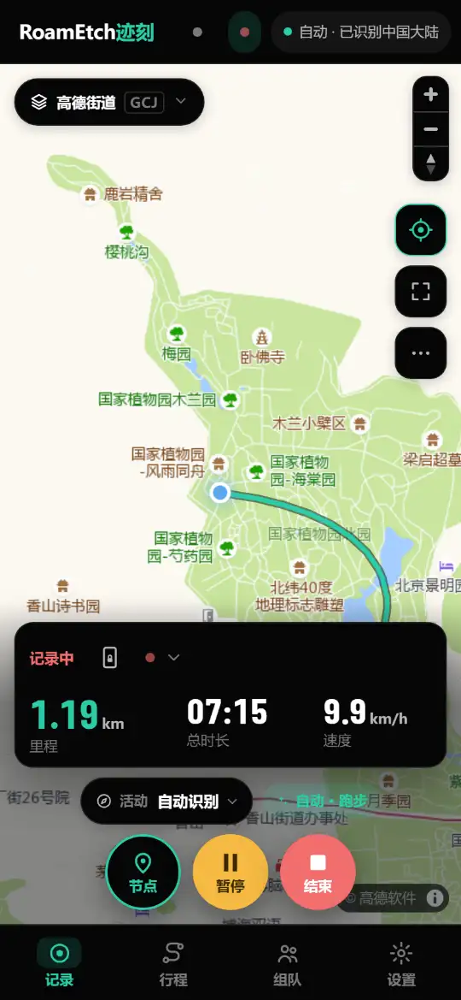
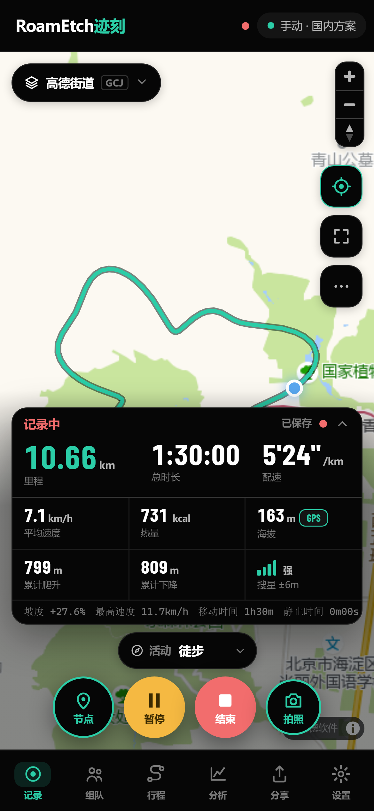
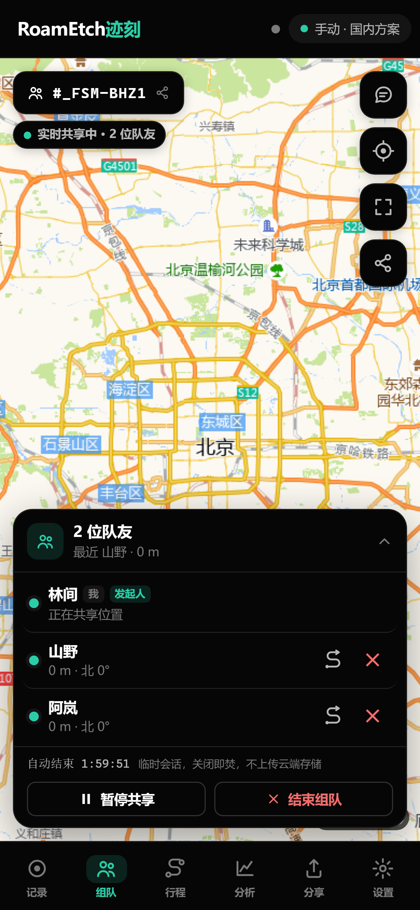
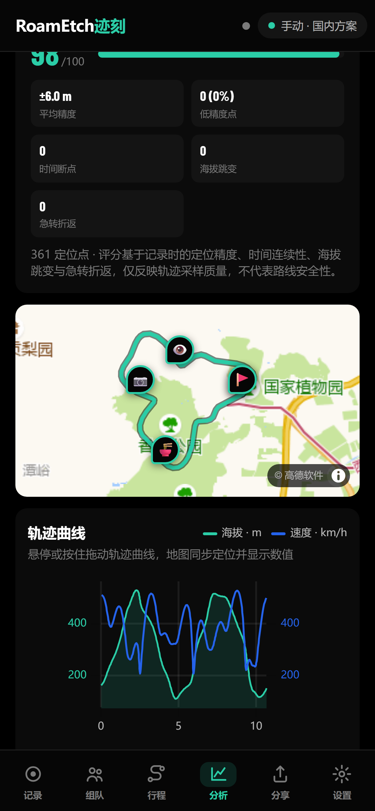
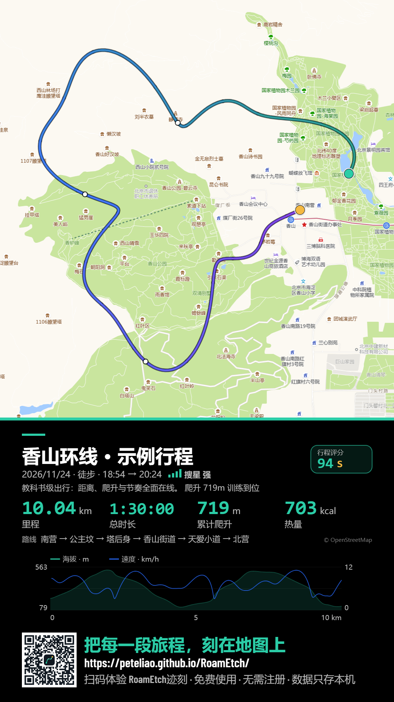
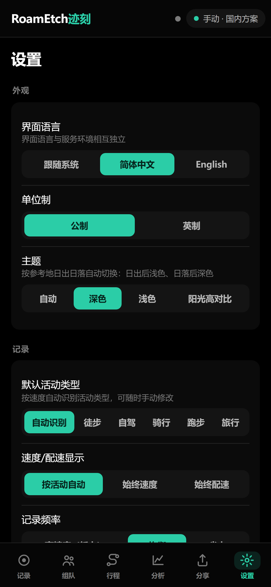
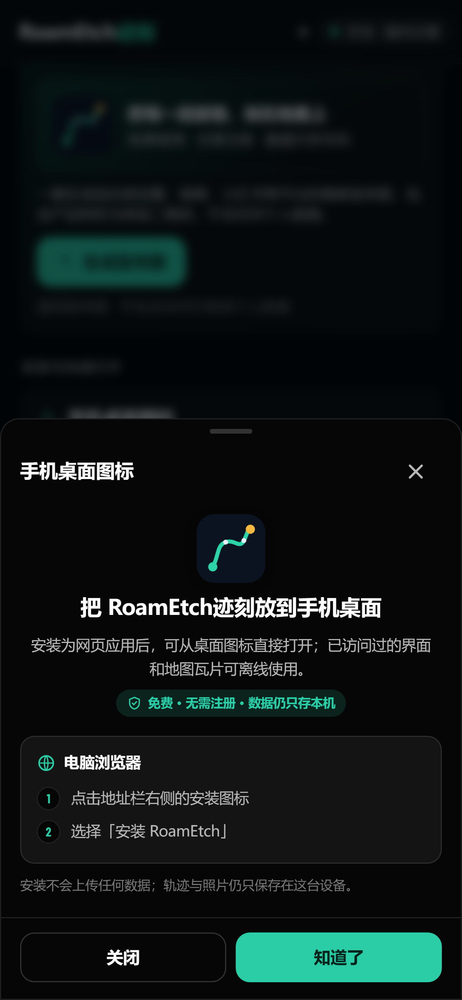

# RoamEtch 迹刻：开源、本地优先的 GPS 轨迹记录与加密实时组队聊天 PWA

简体中文 | [English](README.en.md)

[](LICENSE)
[](https://www.typescriptlang.org/)
[](https://peteliao.github.io/RoamEtch/)
[](https://peteliao.github.io/RoamEtch/)

**RoamEtch 迹刻**（中文名“迹刻”，读音 jìkè）是一款免费开源、无需注册的 GPS 轨迹记录 Web 应用。**Roam** 代表漫游、公路旅行与徒步探索，**Etch** 代表将旅程刻印下来。它把徒步、骑行、自驾、跑步和旅行轨迹记录、海拔与速度分析、GPX 导入导出、分享海报、轨迹视频、自包含网页，以及端到端加密的实时组队与临时聊天放在同一个页面里。数据默认只保存在本机浏览器，安装为 PWA 后可像原生应用一样从桌面启动。

**在线体验：[https://peteliao.github.io/RoamEtch/](https://peteliao.github.io/RoamEtch/)**<br>
手机浏览器可直接打开；iPhone / iPad 请使用 Safari，并从分享菜单添加到主屏幕。

> **没有 GPS 也能体验**：进入「行程」页点击「加载示例行程」，或直接打开 `?demo=1`，即可查看分析、海报、视频与离线网页导出；贡献者可用 `?sim=1` 在桌面端模拟一段实时记录。

> **快速了解**：如果你在寻找一款隐私优先的 GPX 轨迹记录器、可离线使用的徒步/骑行/自驾轨迹 App，或支持实时队友位置共享的户外 PWA，RoamEtch 不需要账号、不上传行程库，打开网页即可开始记录。

## 界面预览

<p align="center">
  
  <br><sub><b>实时记录</b> · 每一步都在地图上生长，里程、时长与速度实时刷新</sub>
</p>

<table>
  <tr>
    <td align="center" width="50%"><br><sub><b>实时记录</b> · 轨迹、海拔、爬升、GPS 信号与活动识别</sub></td>
    <td align="center" width="50%"><br><sub><b>实时组队</b> · 队友位置、距离方向、加密临时聊天</sub></td>
  </tr>
  <tr>
    <td align="center"><br><sub><b>行程管理</b> · 本地轨迹库、年度统计、城市足迹与批量导入导出</sub></td>
    <td align="center"><br><sub><b>行程分析</b> · 高程/速度曲线、坡度、评分与地图节点</sub></td>
  </tr>
  <tr>
    <td align="center"><br><sub><b>分享海报</b> · 轨迹地图、评分、高程与品牌二维码</sub></td>
    <td align="center"><br><sub><b>分享与隐私</b> · 隐私圈裁剪、海报视频、GPX/网页导出</sub></td>
  </tr>
  <tr>
    <td align="center"><br><sub><b>个性化</b> · 中英双语、单位制、OLED 友好主题</sub></td>
    <td align="center"><br><sub><b>安装到桌面</b> · iOS / Android / 桌面逐步引导</sub></td>
  </tr>
</table>

## 为什么选择 RoamEtch

- **本地优先，数据主权归你**：行程、轨迹点、节点与照片保存在浏览器 IndexedDB 中，没有账号、没有云端行程库；可随时整库备份、恢复或导出。
- **一个网页，完整闭环**：记录 → 分析 → 海报/视频/网页 → GPX/GeoJSON/KML，全流程在本地完成，不需要在多个工具之间搬运数据。
- **隐私不是附加选项**：分享数据只放在 URL `#` 片段；起终点隐私圈可裁剪轨迹；照片写入前剥离 EXIF；坐标始终以 WGS-84 存储和导出。
- **实时组队与加密聊天，中继只见密文**：邀请链接包含独立随机房间标识与 256 位密钥，位置、文字、缩略图与 WebRTC 信令经 AES-256-GCM 加密后由公共 MQTT 或自建 WS 中继盲转发；高清原图仅在主动加载时通过加密点对点直传，不经过中继。房间和消息不存入云端。
- **国内 / 海外地图自适应**：按网络环境选择高德、天地图或 OpenStreetMap、OpenTopoMap、Esri，并允许手动切换或使用自定义瓦片；坐标偏移只在渲染层处理。
- **开源可审计**：GPL-3.0 许可，TypeScript + 原生 DOM，无黑盒 SDK；可以自行部署到任意静态托管。

**适合**：周末徒步、越野跑训练、城市骑行、长途自驾、旅行足迹、露营与车队协同、景区找人，以及需要把轨迹导入两步路、Garmin、Strava 等兼容工具的用户。

## 功能一览

### 记录：打开网页就能出发

- 实时显示里程、总时长、移动/静止时间、当前速度、平均速度、配速、海拔、累计爬升/下降、热量与 GPS 搜星强度。
- 按速度自动识别徒步、自驾、骑行、跑步与旅行，也可在记录中随时修改活动类型。
- 支持暂停/继续、记录中打点、结束后重命名；切后台或锁屏中断后自动分段续记，并识别轨迹断点。
- 记录频率提供高精度、均衡、省电三档；支持屏幕常亮、全屏与 OLED 纯黑口袋锁，减少长时间记录的误触与耗电。按电源键锁屏或切后台时，浏览器仍可能暂停定位。
- **网页内拍照节点**：记录中或暂停时点击相机，取景器内直接拍摄并关联当前 WGS-84 坐标与海拔；支持闪光、震动、连续拍摄、缩略图、撤销和“完成 (N)”。每次拍摄都会保留网页内 1600 px 版本与全分辨率原图，可点“存原图”通过系统分享、保存选择器或下载交给本机相册/文件；浏览器不允许网页静默写入系统相册。照片写入本地 IndexedDB，不会上传。
- **节点相册多选与连拍**：节点编辑器可一次选择多张图片，也可直接打开相机连拍，拍多少张就加入多少张，逐张预览后再保存节点。
- **口袋锁快速拍照**：在 OLED 口袋锁底部把相机旋钮向左拖动至少 120 px 即可拍摄，轻点或短拖不会误触；相机 20 秒无操作自动关闭，拍完 3 秒自动回到黑屏口袋锁，也可选择“再拍一张”或“立即锁定”。
- **重走行程**：沿参考轨迹跟随导航，偏离提醒，接近节点时语音播报类型、名称与说明。

### 分析：把一条轨迹读懂

- 紧凑的 13 项统计卡（4 项主指标 + 9 项明细）：距离、时长、平均/最高速度、配速、移动/静止时间、爬升/下降、最高/最低海拔、热量与轨迹点数。
- 高程剖面与速度曲线联动地图；电脑悬停、手机按住拖动，都能在地图上同步定位并查看实时数值。
- 坡度分布、难度参考、分段间隙识别、时间线与沿途节点；可选活动类型后估算热量与完成质量评分。
- **GPS 质量报告**：按真实采样计算平均定位精度、低质量定位比例、时间断档与海拔跳变，给出 0–100 评分与改进提示。
- 支持一键将断点两端坐标发送至公开路网服务（BRouter / OSRM）补全道路轨迹。

### 整理：让足迹可检索

- 收藏置顶、最多 8 个标签，按名称或标签搜索，并按活动类型与收藏筛选；支持最近更新、最新创建、距离最长与名称排序。
- **年度足迹**：按年汇总行程数、里程、爬升、活动天数与 12 个月分布，长期记录一眼可见。
- **年度足迹分享**：一键生成 1080×1350 年度总结图片，或 9 秒 1080×1920 足迹视频（含设备端原创配乐），支持预览、保存与系统分享；只输出年度汇总，不含行程名称、轨迹、地点与照片。
- 收藏、标签、年度统计与分享素材都只在本机生成，不会上传。

### 分享与导出：从轨迹到作品

- **图片海报**：竖版 1080×1920 与方形 1080×1080，包含轨迹地图、起止时间、评分、GPS 信号、高程剖面、路线地名与品牌二维码；根据深浅主题自适应配色。
- **轨迹视频**：10 / 15 / 30 秒地图回放，参数同步展示；内置 4 段设备端合成的循环纯音乐，默认随机、可手动选择，并随 MP4 / WebM 一起导出，可下载或调用系统分享。
- **自包含网页**：导出一个可离线打开的单文件 HTML，内含完整统计、海拔曲线、可缩放地图、节点与照片，适合发给没有安装 App 的朋友。
- **标准文件**：GPX（WGS-84，兼容两步路 / Garmin / Strava 等）、GeoJSON、KML；支持 GPX、XML 与 ZIP 批量导入，以及批量导出 ZIP。
- **可验证备份**：整库 ZIP 写入 SHA-256 内容校验；恢复前显示导出时间、内容、重复行程与校验结果，可先导出当前数据库快照，校验失败会阻止恢复。恢复会先校验压缩包大小、路径、条目与数据关联，再在单个事务中写入，失败自动回滚。备份可选用密码加密（PBKDF2-SHA-256 60 万次 + AES-256-GCM，新文件使用 `.roametch.enc`，旧 `.trackmint.enc` 备份仍可恢复）；未加密的备份请存放在可信位置。
- **轻量分享链接**：把简化轨迹与节点压缩进 1.5 KB 以内的 URL `#` 片段，对方打开即可导入，不生成公开网页，也不包含照片。
- **应用宣传图**：设置页一键生成 1080×1350 宣传图；每套主题内置 8 款设计与中英文对应文案，覆盖本机优先、年度足迹、加密组队、户外分析、旅程视频、后台续记、城市足迹与隐私受众，随机展示且不会连续重复，可在预览中逐张“换一张”。只含产品信息与二维码，不含任何个人数据。
- **隐私检查**：起终点隐私圈、敏感节点隐藏、照片 EXIF 剥离、WGS-84 导出提示集中在同一页，导出前一眼确认。

### 实时组队：和同行者保持在一起

- 发起高熵邀请，通过链接或二维码邀请队友；加入时可使用相机扫码，也可从相册选择二维码图片识别；支持 1 / 2 / 4 / 8 小时自动结束。
- 地图实时显示自己与队友位置、距离和方向，列表给出最近队友与信号中断状态；可为指定队友规划汇合路线。
- 邀请码内含 256 位随机密钥，房间标识与密钥相互独立；位置和聊天消息在设备端加密。默认并发连接多个公共 MQTT WSS 服务商（EMQX 中国/全球节点与 mqtt-dashboard），最快节点就绪即开始收发，其余已连接节点也同步转发作为冗余；可在设置中自定义 MQTT 地址与主题前缀，或切换为自建 WS 中继，中继只转发密文。
- 组队成功后可与在线队友临时聊天，支持未读提示；消息只保存在本机内存，新加入的队友看不到历史消息，离线期间也不会补发，结束后即清除。
- **加密图片聊天**：相机按钮直接打开网页取景器，可翻转、补光、从相册选择、添加说明并预览压缩后尺寸/大小；缩略图按弱网逐档压缩（长边 720 px，省流模式 480 px，上限 56 KB），端到端加密发送，5 秒发送冷却。收到图片显示加密标识，可放大查看；若拍摄时有定位，可一键在地图标记拍摄点。
- **按需加载高清原图**：开启默认关闭的「原图点对点传输」后，队友主动点击「加载原图」才会建立一对一 WebRTC DataChannel；原图以 16 KiB 分片直传并校验 SHA-256，完成后空闲 30 秒自动断开。关闭、超时或校验失败只影响本次原图加载，定位、文字与缩略图照常使用。
- 聊天缩略图只保留本次会话内存中最新 20 张，旧图片释放为占位提示；发送方原图缓存最多 10 张/50 MB，接收方最多 4 张/64 MB。聊天图片不写入 IndexedDB、不进入备份，也不上传到 RoamEtch 服务器。
- 支持暂停共享、恢复共享、发起人移除队友、重置邀请和主动结束；到期或关闭后清除本机会话。
- 邀请、房间与聊天只存在于链接 `#` 片段和本机内存，不会写入云端；适合徒步队伍、自驾车队、露营与景区找人。

> 组队依赖网络与浏览器定位。锁屏或切后台时系统可能暂停 GPS；它不是 SOS 或专业救援工具。纯前端应用无法强制恶意客户端下线，也无法删除对方设备已经收到的位置。开启原图直连后，两台设备在打洞与传输期间可以看见彼此的网络 IP 地址；STUN/TURN 也会收到相应连接信息。旧版 12 位组队码已停用，升级后请重新生成邀请。

### 安装到桌面与离线

- 移动端首次访问会出现一次性安装提示，设置页也保留永久入口；iOS、Android 与桌面端分别展示对应步骤。
- 安装为 PWA 后可从桌面图标直接打开，应用外壳与浏览过的地图瓦片会进入离线缓存。
- 已加载的界面可离线打开，记录、统计、海报、视频和文件导出均可在本机完成；首次访问、未缓存地图区域、组队与部分地名/路网服务仍需联网。
- 应用更新由你确认后才会重新加载；记录中或暂停中不会触发更新，避免打断行程。写入失败的轨迹点会留在本机并自动重试。
- 定位能力需要 HTTPS（或 localhost）与浏览器定位权限。
- 地图渲染使用 MapLibre GL JS 6，需要浏览器支持 WebGL2（近年 Chrome、Edge、Safari、Firefox 均支持）。

### 地图与坐标

- 国内环境优先高德街道/卫星、天地图；海外环境使用 OpenStreetMap、OpenTopoMap、Esri 影像等，并可按网络自动探测或手动选择图源。
- 支持自定义栅格瓦片；底图 CORS 受限或离线时可降级为纯矢量绘制。
- 存储、分析、GPX/GeoJSON/KML 导出始终使用 WGS-84；仅当底图为 GCJ-02（如高德）时在渲染层做本地偏移，原始数据不被污染。

### 主题与语言

- 深色（OLED 友好纯黑）、浅色、阳光高对比三套主题，可按当地日出日落自动切换。
- 简体中文与 English 界面，支持公制/英制；语言与服务环境相互独立，出国使用不会被强制切换地图。

## 安装到手机桌面

1. **iPhone / iPad**：使用 Safari 打开 [在线地址](https://peteliao.github.io/RoamEtch/)，点击底部「分享」，选择「添加到主屏幕」，再点「添加」。iOS 只能通过 Safari 分享菜单安装。
2. **Android**：使用 Chrome 或 Edge 打开，打开浏览器菜单，选择「安装应用」或「添加到主屏幕」。
3. **桌面浏览器**：Chrome / Edge 地址栏出现安装图标时点击即可；也可在应用内「设置 → 手机桌面图标」查看步骤。

安装不会上传任何数据；轨迹与照片仍只保存在这台设备。删除浏览器数据或卸载 PWA 前，请先在「行程」中导出整库备份。

## 快速开始

直接打开在线体验即可，无需安装：

**<https://peteliao.github.io/RoamEtch/>**

本地开发或自行部署：

```bash
npm install
npm run dev        # 开发服务器
npm run typecheck  # TypeScript 类型检查
npm test           # 核心算法单元测试
npm run build      # 类型检查 + 生产构建（dist/）
npm run preview    # 预览生产构建
```

`dist/` 是完全静态的，可部署到 GitHub Pages、Cloudflare Pages、Netlify、Vercel 或任意静态服务器。项目没有业务后端，不需要数据库。CI 会在每次 Push / PR 时运行类型检查、单元测试、Playwright 端到端冒烟测试和生产构建；推送 `v*` 标签时会自动生成 GitHub Release（附 `roametch-dist.zip`）并推送容器镜像。

### Docker 自托管

仓库自带多阶段 `Dockerfile` 与 `nginx.conf`（已为 `sw.js`、`index.html` 设置正确的 PWA 缓存头）。发布标签会自动构建镜像到 GitHub Container Registry：

```bash
docker run --rm -p 8080:80 ghcr.io/peteliao/roametch:latest
# 打开 http://localhost:8080
```

也可以从源码构建：

```bash
docker build -t roametch .
docker run --rm -p 8080:80 roametch
```

手机访问定位与安装 PWA 需要 HTTPS（`localhost` 除外），请在前面加一层 Caddy / Nginx / Cloudflare Tunnel 等 TLS 反向代理。国内 NAS、云服务器或内网机器可直接用这条命令运行，不依赖 GitHub Pages。

### 私有组队中继（可选）

默认会自动并发使用多个公共 MQTT 节点，适合测试。需要更稳定或更私密的组队中继时，可使用 [`relay/`](relay/README.md) 中的极简 WebSocket 盲中继：

```bash
docker run --rm -p 8080:8080 ghcr.io/peteliao/roametch-relay:latest
# 或从源码：
cd relay && npm install && npm start
# 或
docker build -t roametch-relay ./relay
docker run --rm -p 8080:8080 roametch-relay
```

随后在「设置 → 组队中继」选择自建 WS，并填入 `wss://你的域名/room/{room}`。中继只转发密文，不落盘、不记录消息内容。

## 技术架构

- 构建：[Vite 6](https://vite.dev/) + TypeScript + 原生 ES Modules，无前端框架
- 地图：[MapLibre GL JS](https://maplibre.org/)，栅格底图样式自包含，无外部样式/字体依赖
- 存储：[Dexie](https://dexie.org/)（IndexedDB），统计计算使用 Web Worker
- 图表：[uPlot](https://github.com/leeoniya/uPlot)
- 国际化：[i18next](https://www.i18next.com/)
- 文件与图片：fflate（ZIP）、exifr（EXIF 解析与剥离）
- 离线：[vite-plugin-pwa](https://vite-pwa-org.netlify.app/)（Workbox）
- 组队：v2 邀请（128 位随机房间标识 + 256 位密钥）+ HKDF-SHA-256 + AES-256-GCM；唯一 nonce、普通包按发送者序号防重放，RTC 信令单独按发送者/消息 ID 去重并限流；位置、文字、缩略图与信令经多个公共 MQTT WSS 节点或自定义 WS 盲转发，高清原图按需走 WebRTC DataChannel
- 相机：`getUserMedia` + 内联视频 + Canvas；聊天缩略图按弱网压缩并仅在内存中保留最新 20 张，本地拍照保存为关联 WGS-84 坐标的照片节点，并可在会话内另存全分辨率原图
- 测试：Vitest 覆盖坐标转换、轨迹统计、备份完整性、年度足迹、GPS 质量、GPX/KML/GeoJSON、分享链接、组队加密与发布节奏、MQTT 帧校验、QR 解码、聊天图片压缩/校验、备份加密、RTC 信令与传输状态机；Playwright 覆盖示例分析、隐私裁剪、海报、纯文字网页、加密备份往返、网页相机连拍/撤销/原图下载、节点多选与连拍、双端加密图文、相机与图片扫码加入、公共 MQTT 双端收发、WebRTC 按需原图/隐私拒绝/换房竞态、OLED 防误触与自动锁定；CI 运行类型检查、单测、E2E 与生产构建
- 自托管：多阶段 Dockerfile + nginx.conf；组队可选 [`relay/`](relay/README.md) 极简盲中继模板

```text
GPS / GPX / 照片
       │
       ▼
  记录引擎 ──────► IndexedDB（Dexie） ──────► 统计 Worker
       │                    │
       ├── 实时地图          ├── 分析曲线 / 评分 / 断点
       │                    ├── 海报 / 视频 / 单文件网页
       │                    └── GPX / GeoJSON / KML / 备份
       │
       └── 实时组队：设备加密 ──► 公共或自建中继（仅密文）
```

## 与常见方案对比

| 能力 | 典型云端运动平台 | 通用 GPS 记录器 | RoamEtch |
| --- | --- | --- | --- |
| 账号与云端 | 通常需要账号 | 不一定 | 不需要账号，无云端行程库 |
| 轨迹数据位置 | 平台云端 | 本机或文件 | 本机 IndexedDB，可整库备份 |
| GPX 导入 / 导出 | 常有格式或会员限制 | 通常支持 | 导入 GPX/XML/ZIP，导出 GPX/GeoJSON/KML |
| 高程、速度与坡度分析 | 有 | 基础或需另装工具 | 内置统计、曲线、评分与断点补全 |
| 海报 / 视频 / 单文件网页 | 较少 | 少见 | 全部在本地生成 |
| 实时队友位置与聊天 | 有，依赖云端账号 | 少见 | 端到端加密的临时组队会话与聊天 |
| 国内 / 海外底图 | 视产品而定 | 多为手动配置 | 自动探测，也可手动选择 |
| 离线能力 | 有限 | 记录可离线 | PWA 外壳 + 浏览过的瓦片 |
| 开源可审计 | 否 | 视项目而定 | GPL-3.0，代码完全公开 |

## 隐私与数据边界

RoamEtch 的设计原则是“数据默认留在设备上”，但这不等于所有网络请求都消失。实际边界如下：

- **本机保存**：行程、轨迹点、节点、照片缩略图与设置保存在 IndexedDB / localStorage；没有账号体系、业务后端或应用内统计上报。
- **分享链接**：行程数据、组队邀请只放在 URL `#` 片段。浏览器不会把 `#` 后的内容发送给服务器；但收到链接的人可以读取其中的数据，请只分享给信任对象。
- **实时组队**：位置、文字、缩略图与 RTC 信令在设备端加密，默认多个公共 MQTT 中继与自建中继只能看到密文和主题标识，不保存房间或消息。主题标识是独立随机房间 ID，不参与密钥派生；看到主题也无法得到邀请密钥。邀请仍是唯一共享秘密，泄露邀请等同于泄露位置与聊天。中继可观察密文包大小与时间，因此能推断正在传输缩略图或信令，但看不到内容；高清原图字节不经过中继。
- **照片**：本地照片写入存储前剥离 EXIF 位置信息；聊天图片由网页相机/相册在内存中重绘压缩，不写入本机照片库或 IndexedDB，仅保留本次会话最新 20 张缩略图。高清原图仅在内存缓存，默认关闭点对点传输；开启并主动加载后，双方设备与所用 STUN/TURN 可能看见彼此的网络 IP 信息。导出的海报、视频与网页只使用本地处理后的图片。
- **外部服务请求**：底图瓦片、海拔、地名与路网服务需要联网，并会收到渲染或计算所需的坐标/视口请求及常规网络信息（如 IP）。生成海报/视频时，抽样坐标可能用于 OpenStreetMap 系逆地理编码以生成路线地名，结果缓存在本机；断点补全和汇合路线规划只在你主动操作时发送必要的端点坐标。这些请求不会上传照片或整库数据。
- **设备风险**：清除浏览器数据、卸载 PWA 或更换设备会丢失本地行程；请定期使用整库备份。设备本身被他人解锁时，浏览器中的数据也可能被读取。
- **整库备份**：备份 ZIP 包含完整轨迹、节点与照片；默认未加密，任何拿到文件的人都能读取内容。导出时可设置密码加密为 `.roametch.enc`（旧 `.trackmint.enc` 备份仍可恢复；PBKDF2-SHA-256 60 万次 + AES-256-GCM），密码不会被保存，遗失后无法恢复。无论是否加密，请把备份存放在可信位置。
- **自制配乐**：轨迹视频的纯音乐由浏览器实时合成，不下载或打包任何外部音乐素材。

## 常见问题

### RoamEtch 是免费开源的吗？

是。项目以 GPL-3.0 开源，在线版免费使用，无账号、无付费墙；你也可以把 `dist/` 部署到自己的静态托管。

### 会不会上传我的轨迹？

不会上传到 RoamEtch 的业务服务器，因为项目没有业务后端和云端行程库。底图、海拔、地名与路网等第三方服务会收到完成对应功能所需的坐标请求；详见上面的“隐私与数据边界”。

### 可以离线记录吗？

可以。安装为 PWA 后应用外壳和浏览过的地图瓦片会缓存，记录、统计与导出在本机完成。未浏览过的地图区域、在线地名、组队与部分路网服务需要网络。

### 支持哪些文件格式？

导入支持 GPX、XML 以及包含 GPX/XML 的 ZIP；导出支持 GPX、GeoJSON、KML，另有图片海报、MP4/WebM 轨迹视频、自包含 HTML 网页和整库备份。GPX 与 GeoJSON/KML 均使用 WGS-84。

### 实时组队安全吗？

组队位置、文字、缩略图与 WebRTC 信令使用 AES-256-GCM 端到端加密，邀请码内含 256 位随机密钥，房间标识与密钥相互独立；公共或自建中继只转发密文，消息和缩略图只存本机内存且不补发历史。缩略图按弱网压缩、5 秒发送冷却，仅保留最新 20 张，不写入 IndexedDB 或备份。高清原图默认不直传；开启后仅在主动加载时通过 DTLS 加密的一对一 DataChannel 传输，并校验 SHA-256，此时双方设备可见彼此网络 IP。请通过可信渠道发送邀请，不要把链接发到公开群。旧版 12 位组队码已明确停用，不会静默降级。它不是 SOS/救援工具，也不能阻止已收到位置、消息或图片的人保存数据。发送者身份认证、成员变动后的密钥轮换与前向保密仍在后续协议阶段。

### 锁屏后还能继续记录吗？

记录时默认申请屏幕常亮，并提供 OLED 纯黑口袋锁与后台恢复分段。口袋锁只保持仪表盘常亮，不会隐藏页面，也不能阻止系统休眠：iOS/Android 在按电源键锁屏或切后台时仍可能暂停浏览器定位；返回后应用会重新定位并续记。口袋锁底部相机旋钮向左拖动至少 120 px 可在不解锁的情况下拍照，20 秒无操作自动关闭相机，拍完 3 秒回到黑屏锁定。不同系统与省电策略下表现不同，重要活动建议保持应用在前台。

### 为什么国内和海外看到的地图不一样？

RoamEtch 会根据网络环境选择服务栈：国内优先高德/天地图，海外使用 OpenStreetMap、OpenTopoMap、Esri 等。也可以手动切换图源；坐标在渲染层适配 GCJ-02，存储和导出始终为 WGS-84。

### 手机上如何安装？

iPhone/iPad 用 Safari 打开后「分享 → 添加到主屏幕」；Android 用 Chrome/Edge 菜单中的「安装应用」或「添加到主屏幕」；桌面 Chrome/Edge 点击地址栏安装图标。应用内设置页也提供逐步引导。

### 如何删除数据或迁移到新手机？

在行程页删除单条行程，或在浏览器设置中清除本站数据即可删除全部本地数据。迁移请使用“整库备份/恢复”；分享链接与导出文件不包含完整照片库，不能替代整库备份。

### 为什么叫“迹刻”？

Roam 代表漫游、公路旅行与徒步探索，Etch 代表将旅程刻印下来。中文名“迹刻”谐音“即刻”——打开网页就能即刻记录，并把旅程刻在地图上。

## 参与贡献

欢迎提交 Issue 或 Pull Request。报告 bug 时请说明浏览器/系统、是否安装为 PWA、地图区域、复现步骤与预期行为，并移除组队邀请、分享链接和个人轨迹。提交代码前请运行：

```bash
npm run typecheck
npm test
npm run build
```

修改组队中继时请同时运行 `cd relay && npm test`。项目约定、双区测试方法和调试入口见 [CONTRIBUTING.md](CONTRIBUTING.md)，模块与数据流见 [docs/ARCHITECTURE.md](docs/ARCHITECTURE.md)；安全模型与私密漏洞反馈见 [SECURITY.md](SECURITY.md)；社区准则见 [CODE_OF_CONDUCT.md](CODE_OF_CONDUCT.md)；版本变更见 [CHANGELOG.md](CHANGELOG.md)。

项目坚持本地优先、无账号、无云端行程库和 WGS-84 数据标准；新增依赖或外部服务时，请同时说明隐私影响。

## 许可

[GPL-3.0](LICENSE) © 2026 Peteliao

本项目基于 GNU General Public License v3.0 开源。你可以自由使用、修改与分发，但衍生作品需以相同许可证开源，并保留版权声明。
