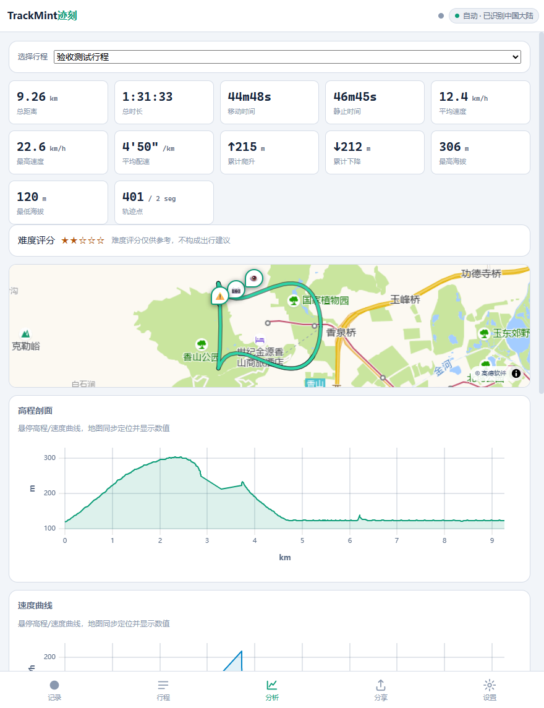

# TrackMint迹刻

**Track（轨迹）+ Mint（铸造/焕新）**；中文“迹刻”谐音**“即刻”**——打开网页即刻记录、当场生成海报。PWA 桌面图标短名：**TrackMint**。

纯前端、离线优先的行程记录与分析分享工具：无后端、数据只存在本机浏览器（IndexedDB），支持国内/海外双区域自适应地图服务，安装为 PWA 后离线可用。

**在线体验（GitHub Pages）：<https://peteliao.github.io/TrackMint/>**



> TrackMint is a pure-frontend, offline-first trip recorder & sharer (PWA). All data stays in your browser; nothing is uploaded. Licensed under GPL-3.0.

## 功能

- **记录**：实时轨迹、省电仪表盘、防误触锁定；定位关闭/后台中断即时提示；活动类型自动识别（步行/跑步/骑行/驾车等）
- **分析**：高程剖面、速度曲线，悬停曲线地图同步定位；分段间隙识别
- **节点**：起点/终点/观光/餐饮/补给/危险等类型，含说明与照片；照片 EXIF 在本地剥离后再存储
- **隐私**：起终点隐私圈裁剪；分享链接数据只放在 URL `#` 片段，永不经过服务器
- **分享**：主题感知海报（方形/竖版）、轨迹视频、自动评分与评语、系统分享、微信内打开引导
- **重走行程**：沿参考轨迹跟随导航，偏离提醒；到达节点时语音播报类型、名称与说明
- **行程管理**：批量导入/导出（GPX / GeoJSON / ZIP）、整库备份与恢复、损坏数据自动隔离
- **双区自适应**：国内优先高德/天地图，海外使用 OSM/OpenTopo/Esri 等服务；按网络环境自动探测切换，也可手动选择图源
- **坐标策略**：存储、分析、导出始终 WGS-84；仅当底图为 GCJ-02（如高德）时在渲染层做本地偏移，数据本身绝不污染
- **主题**：深色 / 浅色 / 阳光高对比，可跟随日出日落自动切换；地图始终为全彩底图
- **PWA**：离线应用外壳、瓦片缓存、可安装到桌面/主屏

## 技术栈

- 构建：[Vite 6](https://vite.dev/) + 原生 ES Modules（无框架）
- 地图：[MapLibre GL JS](https://maplibre.org/)（栅格底图，样式自包含，无外部样式/字体依赖）
- 存储：[Dexie](https://dexie.org/)（IndexedDB）
- 图表：[uPlot](https://github.com/leeoniya/uPlot)
- 国际化：[i18next](https://www.i18next.com/)
- 文件：fflate（ZIP）、exifr（EXIF 解析/剥离）
- 离线：[vite-plugin-pwa](https://vite-pwa-org.netlify.app/)（Workbox）

## 本地开发

```bash
npm install
npm run dev       # 开发服务器
npm run build     # 生产构建（dist/）
npm run preview   # 预览生产构建
```

> 定位能力需要 HTTPS 或 localhost；手机端请通过部署后的 HTTPS 地址访问，并在浏览器中“添加到主屏幕”以获得接近原生的体验。

## 目录

```
src/
  core/       存储、定位引擎、坐标、区域探测、分享、导出、重走等核心逻辑
  ui/         外壳、记录、行程、分析、分享、设置各视图与地图封装
  styles/     主题与组件样式
public/icons/ PWA 图标
```

## 隐私

数据仅保存在本机浏览器中，不上传、不采集；分享海报/视频在本地生成；分享链接的行程数据只存在于 URL `#` 片段中，不会到达任何服务器。清除浏览器数据或使用整库备份自行迁移。

## 许可

[GPL-3.0](LICENSE) © 2026 Peteliao

本项目基于 GNU General Public License v3.0 开源。你可以自由使用、修改与分发，但衍生作品需以相同许可证开源，并保留版权声明。